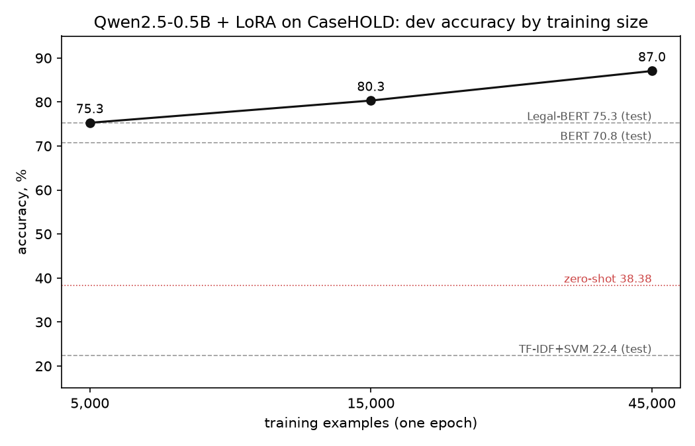

# casehold-lora

Qwen2.5-0.5B fine-tuned on CaseHOLD with a LoRA I wrote myself, in a plain PyTorch loop, on a 6 GB laptop GPU.

## The question

CaseHOLD (Zheng et al., 2021) was built to ask when pretraining on legal text pays off. On the LexGLUE
benchmark, Legal-BERT, pretrained on case law, scores 75.3 on it and plain BERT scores 70.8.

I wanted to know whether a small general-purpose LLM, fine-tuned cheaply, gets to the same place without any
legal pretraining.

## The task

A US court opinion cites an earlier case, and after the citation the judge writes in brackets what that case
decided, its holding. CaseHOLD removes the holding and asks which of five candidates it was.

```
... See United States v. Newman, 125 F.3d 863 (10th Cir.1997) (unpublished) (<HOLDING>); ...

A: holding that possession of a pipe bomb is a crime of violence for purposes of 18 usc 3142f1
B: holding that bank robbery by force and violence or intimidation under 18 usc 2113a is a crime of violence
C: holding that sexual assault of a child qualified as crime of violence under 18 usc 16
D: holding for the purposes of 18 usc 924e that being a felon in possession of a firearm is not a violent felony ...
E: holding that a court must only look to the statutory definition not the underlying circumstances ...
```

The right answer is A. It is the holding the court wrote, so no annotator chose the label.

The four wrong answers are holdings from other cases, and they are picked to be close. Section 3 of the paper:
the authors compute TF-IDF similarity between the correct holding and the pool of other holdings and take the
most similar ones, dropping any above 0.75 similarity as indistinguishable. That is why B to E above are all
about crimes of violence, and why matching words does badly here: TF-IDF with an SVM scores 22.4, and a random
pick scores 20.

I use the LexGLUE copy (`coastalcph/lex_glue`, config `case_hold`) and its fixed split: 45,000 train, 3,900
validation, 3,600 test.

## How it works

**One prompt per question.** An instruction, the citing passage, the five holdings lettered A to E, then
`Answer:`. The model's answer is whichever of the tokens ` A` to ` E` has the highest logit at the last
position. That is one forward pass per question and no new classification head (`data.py`, `eval.py`).

**Long prompts lose context from the left.** The median prompt is 416 tokens and I cap it at 640. The citation
sits at the end of the passage, so the cut comes off the start, and the holdings are never cut. It touches
0.69% of train questions (`lengths.py`).

**LoRA by hand.** `lora.py` is about 30 lines. Each attention projection (q, k, v, o in all 24 layers) keeps
its pretrained weight frozen and adds `(alpha / r) * B A x`, where A and B are two small matrices and the only
things trained: 2,162,688 parameters, 0.436% of the model. B starts at zero, so before training the model is
exactly the pretrained one.

`test_lora.py` checks both halves of that. At init the logits equal the base model's with a max difference of
0.0. With random A and B, the same tensors loaded into Hugging Face `peft` give the same logits, also 0.0.

**Training** (`train.py`) is cross-entropy over the five letter logits, AdamW on A and B, one epoch, bf16
autocast. No hyperparameter was tuned.

## Result

**85.92% on the LexGLUE test split** (3,093 of 3,600), after one epoch on the 45,000 train questions: 62
minutes on an RTX 4050 Laptop GPU, peak 4.3 GiB of VRAM.

| Model | CaseHOLD test | Source |
|---|---|---|
| TF-IDF + SVM | 22.4 | LexGLUE |
| Qwen2.5-0.5B, zero-shot | 38.4 (dev) | this repo |
| BERT | 70.8 | LexGLUE |
| RoBERTa-large | 74.4 | LexGLUE |
| Legal-BERT | 75.3 | LexGLUE |
| CaseLaw-BERT | 75.4 | LexGLUE |
| **Qwen2.5-0.5B + LoRA, 45k** | **85.9** | this repo |

So a general model with a cheap fine-tune ends 10.5 points above the encoders pretrained on case law.

How much data it takes, on the validation split:

| Train questions | Dev accuracy | Training time |
|---|---|---|
| 0 | 38.38% | |
| 5,000 | 75.28% | 10 min |
| 15,000 | 80.33% | 27 min |
| 45,000 | 87.05% | 62 min |



5,000 questions and ten minutes reach 75.28% on dev, level with Legal-BERT's 75.3 on test, and the curve is
still rising at 45,000.

The 45k run was chosen on dev and scored on test once. `RESULTS.md` has every number with the command that
printed it, and `DECISIONS.md` has what I chose at each step and why.

## What the comparison does and doesn't say

- Qwen2.5-0.5B has 494M parameters. BERT and Legal-BERT have about 110M, so the general model is also the
  bigger one. What it didn't get is legal pretraining.
- One seed per run and nothing tuned, so there is no error bar on my numbers.
- The LexGLUE encoders are run as multiple-choice models, which encode the passage with each holding
  separately. Mine reads all five holdings in one prompt, so it can compare them.
- The LexGLUE numbers are from runs with five random seeds.

## Reproduce

```bash
pip install torch==2.6.0 --index-url https://download.pytorch.org/whl/cu124
pip install -r requirements.txt

python test_lora.py                                   # the two LoRA checks
python eval.py --split validation                     # zero-shot
python train.py --n_train 45000 --eval_every 200 --out runs/45k
python eval.py --split test --adapter runs/45k/adapter.pt --batch_size 8
```

It needs a CUDA GPU with 6 GB. The dataset and the base model download from the Hugging Face Hub on first
run.

## Licences and citations

Code: MIT. Qwen2.5-0.5B is Apache-2.0. CaseHOLD was released by its authors under Apache-2.0, and the
LexGLUE copy on the Hub is CC BY 4.0.

- Zheng, Guha, Anderson, Henderson, Ho. *When Does Pretraining Help? Assessing Self-Supervised Learning for
  Law and the CaseHOLD Dataset.* ICAIL 2021. arXiv:2104.08671
- Chalkidis et al. *LexGLUE: A Benchmark Dataset for Legal Language Understanding in English.* ACL 2022.
  arXiv:2110.00976
